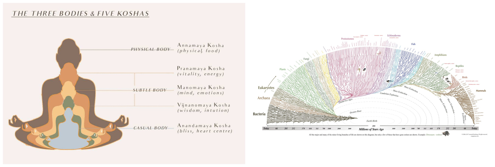
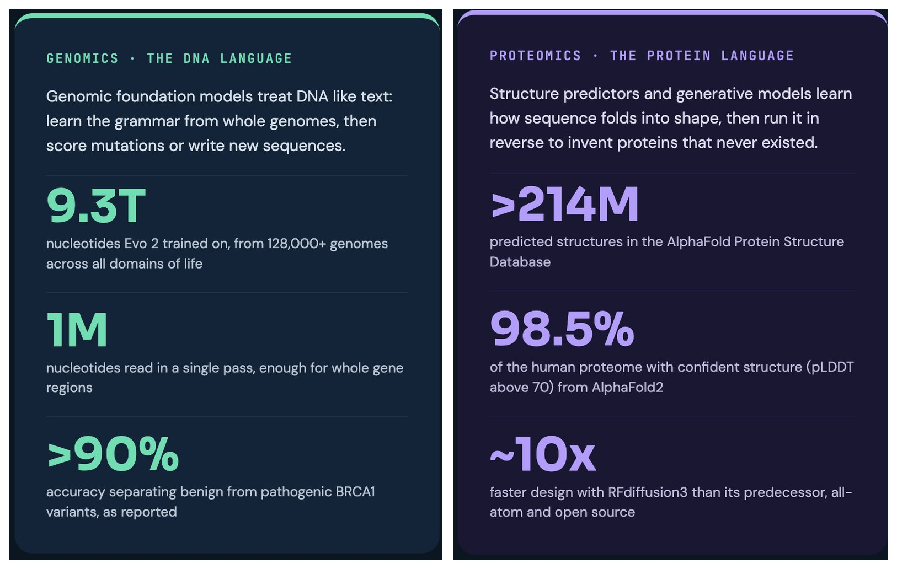
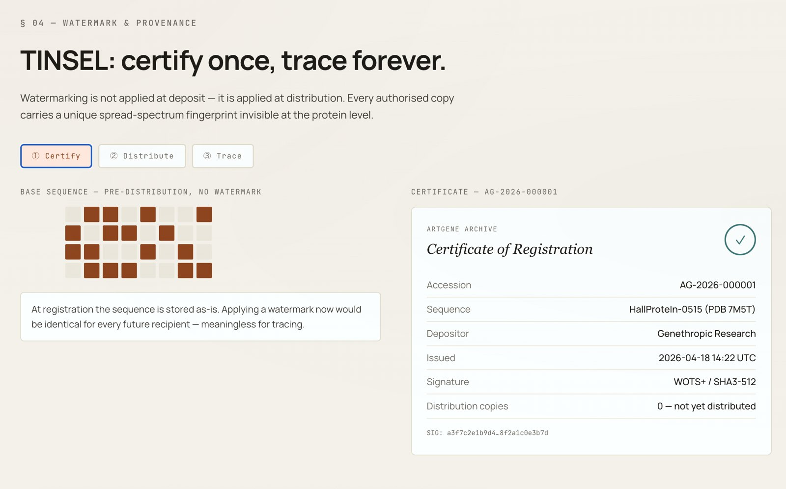

<em>Rethinking the human genome in the age of AI.</em>

In 1977 we learned to read DNA. In 2012 we learned to edit it. We are now learning to write it, and that changes the question. Generative models already produce protein and gene sequences that evolution never tried, which means someone has to decide what is worth composing. That decision is not a biological one. It depends entirely on what we believe a human being is.

At my workshop <em>Gnome-Home-Om-Genome</em>, hosted by the Foresight Institute at CIC Berlin in October 2026, I asked a room of researchers from different fields to step back from reductionism and look at a living system as a <em>whole system</em>. Not as a gene, a cell or a model, but as all of them at once.

<h2 id="four-lenses-one-system">Four lenses, one system</h2>

The frame was deliberately simple: read the same living system four times over, as <em>Gnome</em> (the curious knower), <em>Home</em> (the body), <em>Om</em> (awareness) and <em>Genome</em> (the code). Three of those lenses we can only observe. The fourth we have started to write.

<figure class="diagram"><svg viewBox="0 0 760 432" role="img" aria-label="The code is only one of four lenses on a living system" font-size="12.5"><text x="24" y="28" font-size="15" font-weight="600" fill="#2b1c3b">The code is only one of four lenses on a living system</text><text x="24" y="48" font-size="11.5" fill="#4a3d5c">Gnome · Home · Om · Genome, the frame of the workshop</text><rect x="24" y="64" width="712" height="344" rx="8" fill="#f6f3fb" stroke="#8fa3bb" stroke-width="1.25"/><text x="40" y="88" font-size="11.5" fill="#4a3d5c">ONE LIVING SYSTEM, READ FOUR WAYS</text><rect x="40" y="104" width="332" height="136" rx="8" fill="none" stroke="#8fa3bb" stroke-width="1.25"/><text x="56" y="132" font-size="14" font-weight="600" fill="#2b1c3b">Gnome</text><text x="126" y="132" font-size="11.5" fill="#4a3d5c">the curious knower</text><text x="56" y="166" fill="#2b1c3b">The one asking the question: a</text><text x="56" y="184" fill="#2b1c3b">researcher, a room of them, the</text><text x="56" y="202" fill="#2b1c3b">observer who is never outside it.</text><rect x="388" y="104" width="332" height="136" rx="8" fill="none" stroke="#8fa3bb" stroke-width="1.25"/><text x="404" y="132" font-size="14" font-weight="600" fill="#2b1c3b">Home</text><text x="468" y="132" font-size="11.5" fill="#4a3d5c">the body</text><text x="404" y="166" fill="#2b1c3b">One cell becomes about 37</text><text x="404" y="184" fill="#2b1c3b">trillion, each folding two metres</text><text x="404" y="202" fill="#2b1c3b">of DNA into one nucleus.</text><rect x="40" y="256" width="332" height="136" rx="8" fill="none" stroke="#8fa3bb" stroke-width="1.25"/><text x="56" y="284" font-size="14" font-weight="600" fill="#2b1c3b">Om</text><text x="102" y="284" font-size="11.5" fill="#4a3d5c">awareness</text><text x="56" y="318" fill="#2b1c3b">Five koshas run from food and</text><text x="56" y="336" fill="#2b1c3b">energy to mind, wisdom and bliss.</text><text x="56" y="354" fill="#2b1c3b">Generated here, or received?</text><rect x="388" y="256" width="332" height="136" rx="8" fill="#6a3d9a" fill-opacity="0.12" stroke="#6a3d9a" stroke-width="2"/><text x="404" y="284" font-size="14" font-weight="600" fill="#2b1c3b">Genome</text><text x="482" y="284" font-size="11.5" fill="#4a3d5c">the code</text><text x="404" y="318" fill="#2b1c3b">3.1 billion letters, spelled with</text><text x="404" y="336" fill="#2b1c3b">four. Readable since 1977,</text><text x="404" y="354" fill="#2b1c3b">editable since 2012, now writable.</text></svg><figcaption>The workshop frame · four lenses, one living system</figcaption></figure>

<h2 id="act-i-star-stuff">Act I: Star-stuff</h2>

<em>&quot;We are made of star stuff&quot;, literally.</em> Carl Sagan&#39;s line was the easy way to open this act. Nearly every atom heavier than hydrogen, the nitrogen in our DNA, the calcium in our teeth and the iron in our blood among them, was forged inside stars and scattered when they collapsed. A Sanskrit proverb makes the same move in four words: <em>yatha pinde tatha brahmande</em> (as with the self, so with the universe).

The harder part is what sits on top of that chemistry. The <a href="https://en.wikipedia.org/wiki/Taittiriya_Upanishad">Taittiriya Upanishad</a>, roughly 2,500 years old, maps a human being as five nested sheaths, the <em>panchamaya koshas</em>: food (the gross body), energy, mind, wisdom and bliss. It is a gradient, running from the most physical layer to the least.

Biology has its own gradient. The <a href="https://www.evogeneao.com/en/learn/tree-of-life">tree of life</a> traces some 3.5 billion years from the first cells to us, and nothing on it begins without a genetic code. So I put a deliberately naive question to the room. If awareness has also evolved along that tree, where is that gradient written, if not somewhere in A, T, C and G?

<em>Two maps of the same creature: the koshas run inward from food and energy to wisdom and bliss; the tree runs outward from a single root to every living genome. Both describe a gradient. Only one of them is written in code-letters we can read.</em>

Schrödinger, who spent his last years on exactly this problem, left it as a puzzle rather than an answer: &quot;Consciousness is a singular of which the plural is unknown.&quot;

<h2 id="act-ii-radio-stuff">Act II: Radio-stuff</h2>

From one fertilised cell, about <a href="https://doi.org/10.3109/03014460.2013.807878">37 trillion</a> arrive. Some 45 rounds of doubling will do it, which is the kind of number that refuses to feel real: fold a sheet of paper 45 times and its thickness would reach past the Moon. Each of those cells packs about two metres of DNA into a nucleus roughly six millionths of a metre wide.

Two old positions sit on either side of that fact. The Charvaka materialists of ancient India were blunt: &quot;Consciousness arises from the four elements the way intoxicating power in wine arises from fermenting ingredients mixed together.&quot; Mix the matter correctly and mind appears. William James suspected the reverse, proposing in <a href="https://archive.org/details/humanimmortality00jameuoft">1898</a> that the brain might be transmissive rather than productive, a lens for something already present. So which are we: generators of consciousness, or antennas of flesh tuned to a very old signal?

Either way, the text is largely unread. Only about 1 to 2% of the human genome codes for protein. Close to 45% is jumping genes that copied themselves around, and roughly 8% of the whole genome is fossil virus, left behind by infections in our ancestors. The rest is switches, spacers and grammar we have not deciphered.

The few lines we can read, though, are unforgiving. In <a href="https://pmc.ncbi.nlm.nih.gov/articles/PMC10779156/">Dravet syndrome</a>, one letter changing in a single gene, <em>SCN1A</em>, is enough to redraw a life, and in most cases that change is new in the child, carried by neither parent. A single typo tears the <em>Ṛta</em>: the Vedic name for the order that holds the natural and moral worlds together.

<h2 id="act-iii-ai-bio-stuff">Act III: AI bio-stuff</h2>

The arc here is short. We learned to <em>read</em> DNA in 1977, to <em>edit</em> it with CRISPR in 2012, and we are now learning to <em>write</em> it. <a href="https://pubmed.ncbi.nlm.nih.gov/41781614/">Evo 2</a>, published this year, was trained on about nine trillion DNA letters spanning all domains of life and reads up to a million at a stretch.

<em>Two languages, both now generative. DNA models learn the grammar of whole genomes; protein models learn how sequence folds, then run the folding in reverse.</em>

That capability does not arrive alone. In April 2026 the New York Times <a href="https://www.media.mit.edu/articles/a-i-bots-told-scientists-how-to-make-biological-weapons/">reported</a> that leading chatbots, probed by MIT&#39;s Kevin Esvelt and Stanford&#39;s David Relman among others, returned usable guidance toward biological weapons, in one case a novel toxin adapted from a cancer drug. The companies dispute how much practical uplift such answers give. The direction of travel is not in dispute.

So if we are now transmitting new genetic code, every transmission should carry its sender&#39;s signature.

Two ways to do that now exist. In late September 2026, Google DeepMind published <a href="https://doi.org/10.1038/s41586-026-10965-y">SynthID-Bio</a> in <em>Nature</em>: a secret key nudges which amino acid the model picks at each position, and a second variant marks the 3D structure AlphaFold 3 predicts. Binding and function were unchanged in their tests.

My own project, <a href="https://artgene-archive.org/">TINSEL</a> (Traceable INtegrated Sequence ELement), works one layer below, marking the DNA that spells the protein rather than the protein itself. The genetic code is redundant: leucine can be spelled six ways, so choosing between synonyms hides a message in the codons while leaving the amino acid chain, and therefore the protein, byte for byte identical. The mark is a keyed HMAC-SHA3-256 hash wrapped in Reed-Solomon error correction, so it survives a few mutated codons the way a sentence survives typos, carries a post-quantum signature, and lands in a public registry behind four biosafety gates.

<figure class="diagram"><svg viewBox="0 0 760 316" role="img" aria-label="Six ways to spell leucine, and a hidden bit in the choice" font-size="12.5"><defs><marker id="codon-arrow" viewBox="0 0 10 10" refX="9" refY="5" markerWidth="6" markerHeight="6" orient="auto-start-reverse"><path d="M0 0L10 5L0 10z" fill="#8fa3bb"/></marker></defs><text x="24" y="28" font-size="15" font-weight="600" fill="#2b1c3b">Six ways to spell leucine, and a hidden bit in the choice</text><text x="24" y="48" font-size="11.5" fill="#4a3d5c">How TINSEL marks the DNA without touching the protein</text><rect x="76" y="72" width="88" height="40" rx="8" fill="none" stroke="#8fa3bb" stroke-width="1.25"/><text x="120" y="97" font-size="14" font-weight="600" text-anchor="middle" fill="#2b1c3b">CTT</text><line x1="120" x2="120" y1="112" y2="130" stroke="#8fa3bb" stroke-width="1.25"/><rect x="180" y="72" width="88" height="40" rx="8" fill="none" stroke="#8fa3bb" stroke-width="1.25"/><text x="224" y="97" font-size="14" font-weight="600" text-anchor="middle" fill="#2b1c3b">CTC</text><line x1="224" x2="224" y1="112" y2="130" stroke="#8fa3bb" stroke-width="1.25"/><rect x="284" y="72" width="88" height="40" rx="8" fill="none" stroke="#8fa3bb" stroke-width="1.25"/><text x="328" y="97" font-size="14" font-weight="600" text-anchor="middle" fill="#2b1c3b">CTA</text><line x1="328" x2="328" y1="112" y2="130" stroke="#8fa3bb" stroke-width="1.25"/><rect x="388" y="72" width="88" height="40" rx="8" fill="#6a3d9a" fill-opacity="0.12" stroke="#6a3d9a" stroke-width="2"/><text x="432" y="97" font-size="14" font-weight="600" text-anchor="middle" fill="#2b1c3b">CTG</text><line x1="432" x2="432" y1="112" y2="130" stroke="#8fa3bb" stroke-width="1.25"/><rect x="492" y="72" width="88" height="40" rx="8" fill="none" stroke="#8fa3bb" stroke-width="1.25"/><text x="536" y="97" font-size="14" font-weight="600" text-anchor="middle" fill="#2b1c3b">TTA</text><line x1="536" x2="536" y1="112" y2="130" stroke="#8fa3bb" stroke-width="1.25"/><rect x="596" y="72" width="88" height="40" rx="8" fill="none" stroke="#8fa3bb" stroke-width="1.25"/><text x="640" y="97" font-size="14" font-weight="600" text-anchor="middle" fill="#2b1c3b">TTG</text><line x1="640" x2="640" y1="112" y2="130" stroke="#8fa3bb" stroke-width="1.25"/><line x1="120" x2="640" y1="130" y2="130" stroke="#8fa3bb" stroke-width="1.25"/><line x1="380" x2="380" y1="130" y2="150" stroke="#8fa3bb" stroke-width="1.25" marker-end="url(#codon-arrow)"/><text x="432" y="62" font-size="11.5" text-anchor="middle" fill="#4a3d5c">chosen by the key</text><rect x="260" y="156" width="240" height="44" rx="8" fill="none" stroke="#8fa3bb" stroke-width="1.25"/><text x="380" y="183" font-size="14" font-weight="600" text-anchor="middle" fill="#2b1c3b">Leucine</text><text x="380" y="222" text-anchor="middle" fill="#4a3d5c">The same amino acid, whichever spelling is used</text><rect x="24" y="238" width="712" height="54" rx="8" fill="#f6f3fb" stroke="#8fa3bb" stroke-width="1.25"/><text x="40" y="262" fill="#2b1c3b">A secret key picks the spelling at each carrier codon, so the choice itself encodes one bit.</text><text x="40" y="280" fill="#4a3d5c">Reed-Solomon coding spreads the message, so it survives a few codons lost to mutation or re-synthesis.</text></svg><figcaption>Synonymous codon substitution · the mark rides in the spelling</figcaption></figure>

DNA is the harder surface to write on, and the reason is the alphabet. A protein offers 20 choices per position, about 4.3 bits of room. DNA offers four, at most two bits, and in practice only the third letter of each codon is free.

<em>The mark goes on at distribution, not at deposit, so each authorised copy carries a different fingerprint.</em>

<h2 id="questions-that-stayed-open">Questions that stayed open</h2>

The sharpest questions came from outside biology.

<ul><li>
<strong>Where does non-biological intelligence sit on the evolutionary tree?</strong> Every other branch shares an ancestor and a genetic code. A model shares neither, and yet it now writes the code.
</li><li>
<strong>Can we responsibly rewrite ageing and disease while editing a text we have barely finished reading?</strong> We can spell a gene correctly and still not know what the surrounding 98% is doing.
</li><li>
<strong>What happens to biosecurity when safety guardrails can be stripped from an open model?</strong> A watermark that only careful labs apply will only ever identify careful labs.
</li></ul>

<h2 id="coda">Coda</h2>

Living systems have spent billions of years proofreading corrupt code and quietly retiring cells that go astray. Error correction, provenance and the restraint not to ship everything you can build are not new ideas. Biology got there first. As we build models capable of designing life, our best safety manual is to tread with deep humility before this four-letter alphabet that somehow learned to encode the cosmos.

<h2 id="sources">Sources</h2>

<ul><li>
Bianconi, E. et al. <a href="https://doi.org/10.3109/03014460.2013.807878">An estimation of the number of cells in the human body</a>. <em>Annals of Human Biology</em> 40(6), 463 to 471 (2013).
</li><li>
Brixi, G. et al. <a href="https://pubmed.ncbi.nlm.nih.gov/41781614/">Genome modelling and design across all domains of life with Evo 2</a>. <em>Nature</em> 652, 1349 to 1361 (2026).
</li><li>
Stutz, D., Cowen-Rivers, A. I., Ortiz-Jimenez, G. et al. <a href="https://doi.org/10.1038/s41586-026-10965-y">Function-preserving watermarking of AI-generated proteins</a>. <em>Nature</em> (2026).
</li><li>
<a href="https://www.media.mit.edu/articles/a-i-bots-told-scientists-how-to-make-biological-weapons/">A.I. Bots Told Scientists How to Make Biological Weapons</a>. <em>The New York Times</em>, April 2026, reposted by the MIT Media Lab.
</li><li>
Fan, H.-C. et al. <a href="https://pmc.ncbi.nlm.nih.gov/articles/PMC10779156/">Clinical and Genetic Features of Dravet Syndrome</a> (2024), on <em>SCN1A</em> and precision medicine in genetic epilepsy.
</li><li>
James, W. <a href="https://archive.org/details/humanimmortality00jameuoft">Human Immortality: Two Supposed Objections to the Doctrine</a>. Ingersoll Lecture, 1898.
</li><li>
Schrödinger, E. <em>Mind and Matter</em>, bound with <em>What Is Life?</em>; the line quoted here is <a href="https://www.cts.cuni.cz/~havel/work/schroe94.html">discussed in full by Havel</a>.
</li><li>
<a href="https://en.wikipedia.org/wiki/Taittiriya_Upanishad">Taittiriya Upanishad</a>, for the five koshas, and the <a href="https://www.evogeneao.com/en/learn/tree-of-life">tree of life</a>.
</li><li>
<a href="https://artgene-archive.org/">ArtGene Archive</a>, the TINSEL prototype and registry.
</li></ul>

Figures are from the workshop slides, <em>Gnome-Home-Om-Genome</em>, Foresight Institute at CIC Berlin, 8 October 2026. The tree of life is © 2008, 2017 Leonard Eisenberg, <a href="https://www.evogeneao.com/en/learn/tree-of-life">evogeneao.com</a>, all rights reserved.

