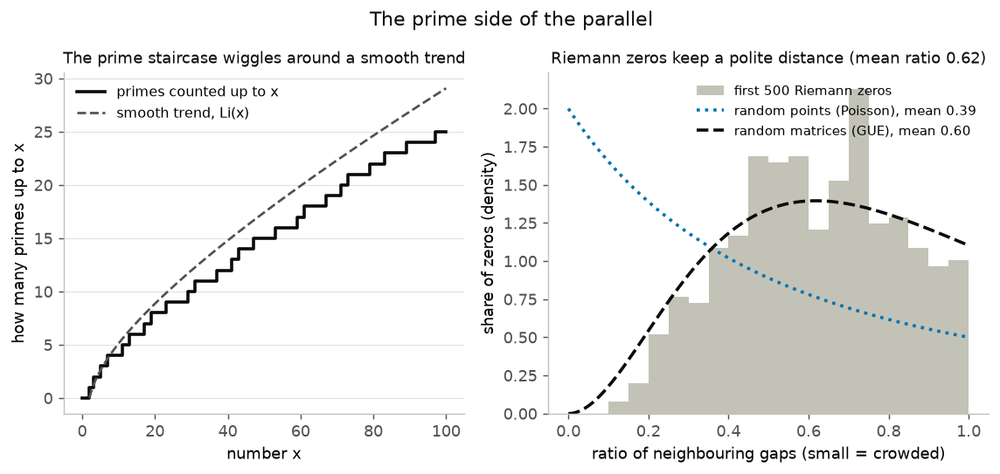
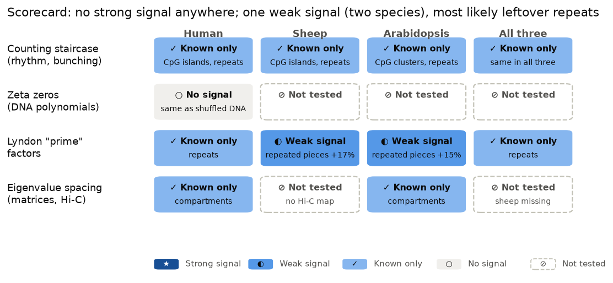
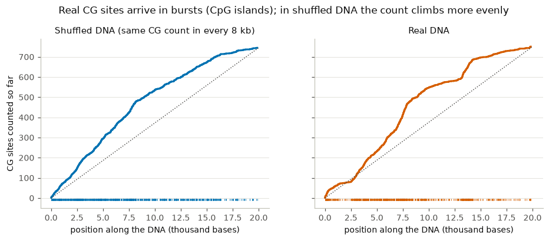
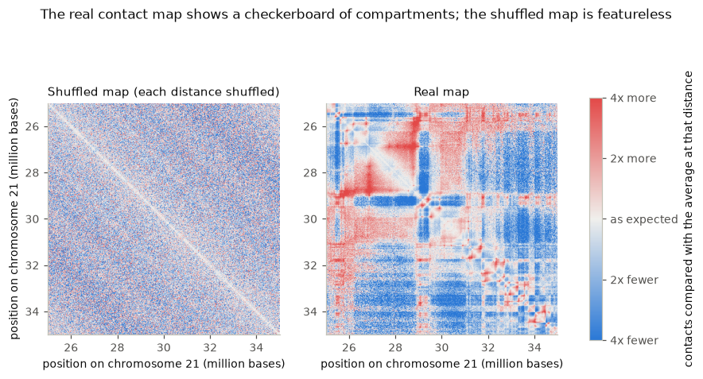
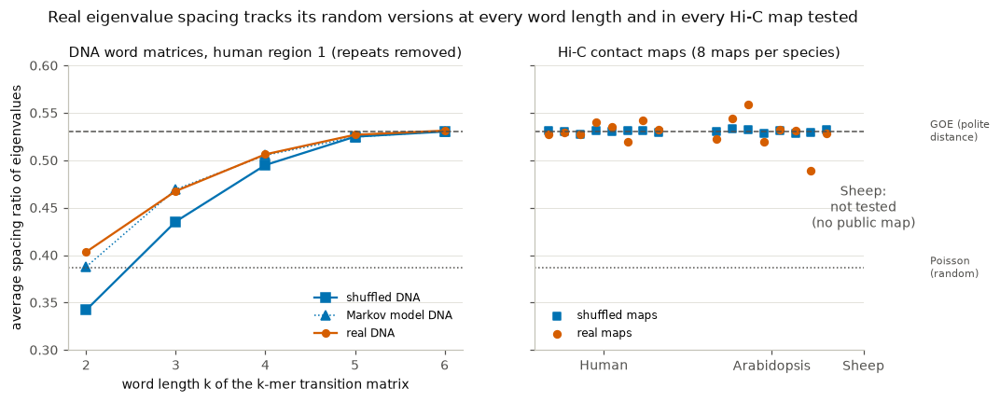

Anthropic's [claimed proof of the Riemann hypothesis](https://www.nature.com/articles/d41586-026-03812-7) is making noise these days. Mathematicians are still checking it, and a rival, all-human proof appeared the same day.

## The music of the primes

Prime numbers look scattered at random: 2, 3, 5, 7, 11, 13 and so on. In 1859 Bernhard Riemann showed they obey a hidden "music", set by the zeros of his zeta function. A century later Hugh Montgomery and Freeman Dyson noticed something uncanny: those zeros are spaced like the energy levels of heavy atomic nuclei. They never crowd together; they keep a polite distance.

*Figure 1. The prime side of the parallel. Left: the prime staircase climbs around a smooth trend. Right: gaps between the first 500 Riemann zeros follow random matrix statistics (GUE), not random points (Poisson).*

A genome also looks random at first glance. So while brainstorming with Claude, I thought: why not ask a deliberately naive question? If we point a number theorist's tools at DNA, does anything hum?

## Four tools borrowed from number theory

We translated four classic ideas from prime research into DNA.

| Prime idea | DNA version | Question |
| --- | --- | --- |
| Count primes, subtract the smooth trend, study the wiggle | Count where a short word (like CG) occurs along the DNA | Hidden rhythm, or bunching? |
| Zeros of the zeta function | Turn 256 letters into a polynomial and find its 255 zeros | Do DNA's zeros sit or space unusually? |
| Prime factors | Lyndon words, DNA's candidate "primes": listed in reverse dictionary order, they split any string in exactly one way | Are the pieces unusual in size or reuse? |
| Zeros spaced like random matrices | Eigenvalues of word matrices and Hi-C maps (which DNA stretches touch in the nucleus) | Do they keep a polite distance? |

## How we tried not to fool ourselves

Pattern hunting risks seeing faces in clouds. So every result had to beat two kinds of fake DNA: one shuffled while keeping every pair of neighbouring letters, and one generated by a model that copies how each letter depends on the few before it. A result also had to reappear in a second, independent 10-million-letter region and survive correction for thousands of tests. We ran everything on three very different genomes: human, sheep and the thale cress *Arabidopsis*. Finally, we planted fake signals to measure what each tool could catch.

## What we found: biology we already knew

Almost everything that stood out is textbook biology.

*Figure 2. Scorecard of the study. Weak signals appear only for Lyndon words in sheep and Arabidopsis.*

The staircase lit up at once, for familiar reasons. CG pairs arrive in bursts called CpG islands, and repeated DNA makes words bunch. In all three species, 93 to 99% of short words were more bunched than in shuffled DNA.

*Figure 3. Counting CG sites along 20,000 letters of human DNA. Real sites come in bursts; shuffled ones climb evenly.*

Hi-C maps showed a striking checkerboard: two kinds of chromatin (A and B compartments) touch their own kind more often. The largest eigenvalues stood about 30 times above shuffled maps in human, as expected: compartments were first mapped in 2009.

*Figure 4. Human chromosome 21 contacts after removing the distance trend: shuffled (left) versus real (right).*

## The plot twist: the music is everywhere

The most instructive result was a near miss. DNA zeros, word matrices and Hi-C maps all showed the polite spacing that made the Riemann zeros famous. But shuffled DNA showed the same spacing: 0.573 to 0.582 for the zeros of real DNA versus 0.577 for shuffled DNA, and about 0.53 for real and shuffled matrices alike. The music came from the instruments, not the genome. Any noisy polynomial or matrix of this kind hums this way, so any random matrix claim in biology needs a shuffled control.

*Figure 5. Eigenvalue spacing of real DNA (orange) tracks its shuffled versions (blue) everywhere we looked.*

## What did not pan out

- The zeros saw nothing that an ordinary frequency analysis of the same data missed, and were no more sensitive.
- One candidate survived every filter: Lyndon pieces that reappear in a region 10 to 24% more often than in shuffled DNA, replicated in sheep and *Arabidopsis*. Stricter repeat filters shrink it in one of the two regions, and its most repeated pieces look like short simple repeats (TATATATG, CACACAGG) too small for our masking to catch. Leftover repeats are the likely cause.
- Sheep has no public Hi-C map, and two tools were run on one human region only.

## Hypotheses worth testing next

1. If the Lyndon excess is leftover repeats, it will vanish once each species gets its own repeat library. If it survives, it is new.
2. If polite spacing is generic, protein sequences and random text will show it too; a deviation would be the interesting case.
3. CG bunching should follow DNA methylation: strong in mammals, weaker in plants, near random in fruit flies, which barely methylate.
4. Hi-C spacing may drift toward random at finer resolution, where loops and domains lock modes in place.

A negative result is still a result. Whatever the checkers decide about the new proofs, the primes keep their music. At least where we looked, the genome does not hum like the primes.
